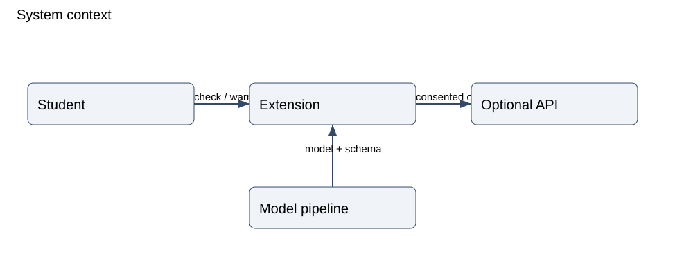
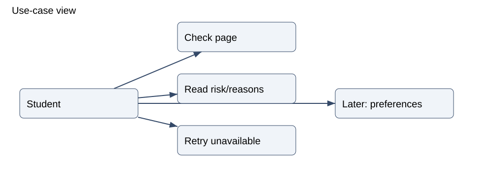
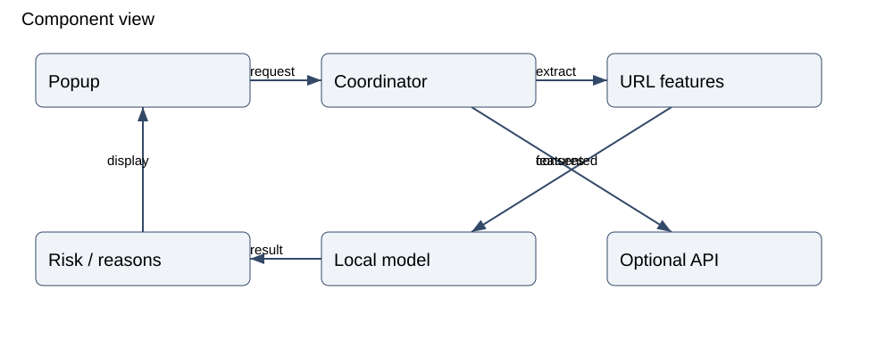

# Architecture diagrams

Proposed design from section 7 of the final report. Each diagram has an editable Mermaid source and a rendered SVG view.

## System context

[Editable source](context.mmd) · [SVG view](context.svg)

## Use cases

[Editable source](use-cases.mmd) · [SVG view](use-cases.svg)

## Components

[Editable source](components.mmd) · [SVG view](components.svg)

